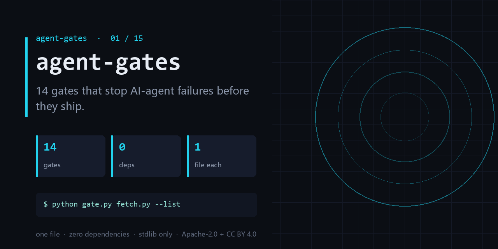

<div align="center">

</div>

<h1 align="center">agent-gates</h1>

<p align="center"><b>14 gates that stop AI-agent failures before they ship — one file each, zero dependencies.</b></p>

<p align="center">
<a href="https://github.com/chenhz01/agent-gates/actions/workflows/index.yml"></a>


</p>

---

Most agent tooling helps you *build* the agent. This series is about the other half:
the moment after it works, when you have to answer **"how do we know it still works?"**

Every gate here is a single `gate.py`, standard library only, run against a file or a
directory you already have. No service, no API key, no `pip install`. Each one exits `0`
or `1` so it can sit in CI, and each one ships with an example that **fails on purpose** —
so you can see the finding before you trust the tool.

## Which one do you need right now

| 你现在卡在哪 | 装这道门 | 它给你的那个数 |
|---|---|---|
| 账单突然翻倍，日志里同一动作反复出现 | [`loop-gate`](https://github.com/chenhz01/loop-gate) | 重复次数 + 停滞区间 |
| 说不清 Agent 到底有多大权限 | [`permission-gate`](https://github.com/chenhz01/permission-gate) | 过度授权分（0-100） |
| 上下文放不下，不知道截哪里 | [`context-gate`](https://github.com/chenhz01/context-gate) | 关键单元存活率 |
| 提示词越写越长，规则开始打架 | [`instruction-gate`](https://github.com/chenhz01/instruction-gate) | 冲突条款对 |
| 内容要发出去，怕留占位符和假数字 | [`output-gate`](https://github.com/chenhz01/output-gate) | BLOCK / WARN 计数 |
| 记忆越积越多，旧的还在当规则执行 | [`memory-expiry-gate`](https://github.com/chenhz01/memory-expiry-gate) | 每条记忆的去向 |
| 检索效果好像变差了，但说不清 | [`drift-gate`](https://github.com/chenhz01/drift-gate) | 漂移分 + 最差维度 |
| 要算成本，价格表是手抄的 | [`price-gate`](https://github.com/chenhz01/price-gate) | 价格表错行 |
| 代码越来越难改，改一行崩三处 | [`complexity-ceiling`](https://github.com/chenhz01/complexity-ceiling) | 超预算文件 |
| 不敢删代码，因为"不确定还有没有用" | [`deadcode-gate`](https://github.com/chenhz01/deadcode-gate) | 死代码占比 |
| 文档里的命令早就跑不通了 | [`docrot-gate`](https://github.com/chenhz01/docrot-gate) | 失效引用数 |
| 对外文件里可能带着内部信息 | [`leak-gate`](https://github.com/chenhz01/leak-gate) | 泄露命中 |
| 备份从没验证过能不能还原 | [`backup-gate`](https://github.com/chenhz01/backup-gate) | 不一致文件数 |
| 出事要复盘，日志缺步骤且无法证明没被改 | [`trail-gate`](https://github.com/chenhz01/trail-gate) | 链完整性 |

## The fourteen gates

| # | gate | what it stops | 中文 |
|---|---|---|---|
| 02 | **[loop-gate](https://github.com/chenhz01/loop-gate)** | Find where your agent looped, before it burns another run. | 死循环门 |
| 03 | **[permission-gate](https://github.com/chenhz01/permission-gate)** | Score how much more your agent can do than it should. | 权限门 |
| 04 | **[context-gate](https://github.com/chenhz01/context-gate)** | Measure what truncation deletes, before the model starts guessing. | 上下文门 |
| 05 | **[instruction-gate](https://github.com/chenhz01/instruction-gate)** | Two of your instructions contradict each other. This finds them. | 指令门 |
| 06 | **[output-gate](https://github.com/chenhz01/output-gate)** | Before AI-written text ships, run the four checks it always fails. | 产出体检门 |
| 07 | **[memory-expiry-gate](https://github.com/chenhz01/memory-expiry-gate)** | Give every memory a TTL, then prove the expiry semantics actually hold. | 记忆过期门 |
| 08 | **[drift-gate](https://github.com/chenhz01/drift-gate)** | When embeddings drift, retrieval quietly rots. Fingerprint it. | 嵌入漂移门 |
| 09 | **[price-gate](https://github.com/chenhz01/price-gate)** | Your cost model is only as good as the price table under it. | 价格表门 |
| 10 | **[complexity-ceiling](https://github.com/chenhz01/complexity-ceiling)** | Per-file complexity budgets that fail the build instead of the reviewer. | 复杂度上限门 |
| 11 | **[deadcode-gate](https://github.com/chenhz01/deadcode-gate)** | Quantify how much of the repo is dead, instead of guessing. | 死代码门 |
| 12 | **[docrot-gate](https://github.com/chenhz01/docrot-gate)** | Docs don't die at once. They rot one stale command at a time. | 文档腐烂门 |
| 13 | **[leak-gate](https://github.com/chenhz01/leak-gate)** | Scan for internal detail before the doc leaves the building. | 泄露门 |
| 14 | **[backup-gate](https://github.com/chenhz01/backup-gate)** | A backup you have never verified is a rumor. | 备份门 |
| 15 | **[trail-gate](https://github.com/chenhz01/trail-gate)** | Hash-chained agent audit trail — and it verifies its own chain. | 轨迹门 |

## What they share

- **One file, stdlib only.** `python gate.py --help` is the whole install.
- **Two outputs.** Human text by default, `--json` when a machine reads it.
- **Exit `0` or `1`.** No ambiguous codes, no "2 means warning but also failure".
- **A failing example.** Every `examples/` is built to trip the gate — a demo that passes proves nothing.
- **A written boundary.** Each README has a *What it does not do* section. Read that before you trust the number.
- **Dual license.** Code Apache-2.0, docs CC BY 4.0.

## Get them

Fetch one:

```bash
python fetch.py loop-gate
```

Fetch all fourteen:

```bash
python fetch.py --all
```

List without downloading:

```bash
python fetch.py --list
```

Files land in `.gates/<name>/`, each with its `examples/`. No git required — `fetch.py`
uses the GitHub API through `urllib`.

## Use one in CI

```yaml
- name: loop-gate
  run: |
    python .gates/loop-gate/gate.py check trace.jsonl --window 6 --repeat-threshold 3
```

Or reference the repo directly as a composite action — every gate ships an `action.yml`.

## Why fourteen repos and not one

Because each gate has a different audience, a different failure mode, and a different
maintenance rhythm. Merging them into one tool would mean one version number, one issue
tracker, and fourteen reasons to block a release. Split, each one can be read, tested and
replaced on its own — and if you only need `drift-gate`, you never pay for the other thirteen.

The trade-off is real: no shared installer, no unified CLI. `fetch.py` is the smallest
thing that removes most of that cost.

## 中文速览

**一句话**：这 14 个仓是一套「AI Agent 上线后的自检门」——每个是一份零依赖的单文件脚本，
对着你已有的文件或目录跑一次，给出一个能进 CI 的 0/1 结论。

**为什么分开**：每道门受众不同、失败方式不同、维护节奏不同。合成一个工具＝一个版本号、
一个 issue 列表、十四个阻塞发版的理由。分开后，你只需要 `drift-gate` 就不用为其余十三个付费。

**共同约定**：单文件 / 零依赖 / 文本与 JSON 双输出 / 退出码只有 0 和 1 /
自带一个**故意失败**的例子 / 明确写出「不做什么」/ 代码 Apache-2.0 + 文档 CC BY 4.0。

**取件**：`python fetch.py --all`

## License

- Code: **Apache-2.0** — see [LICENSE](LICENSE)
- Docs and example data: **CC BY 4.0** — see [LICENSE-SPEC](LICENSE-SPEC)

Attribution required when redistributing the documentation. Code may be used commercially
without a separate agreement. See [NOTICE](NOTICE).
